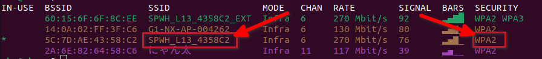

### 🛜Steps to connect g1 to wifi

#check all the connections
```
nmcli connection show
```

# Turn off the hotspot
```
sudo nmcli connection down "Hotspot_Name"
```


#Scan for the wifi
```
nmcli device wifi list
```



#connect to the wifi 
```
nmcli device wifi connect {WIFI_NAME} password {PASSWORD}
```

###⚠️Note:The G1 cannot connect to WPA3. So, the wifi must be WPA2. 

